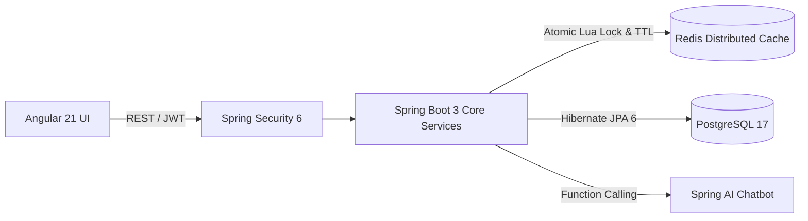

# Spoorthi G Talanki

  <strong>Information Science Engineering Undergraduate</strong> &bull; Bangalore Institute of Technology ('27) 
  <strong>Target Roles:</strong> Software Development Engineer (SDE) &bull; Backend Engineer &bull; Full-Stack Developer &bull; AI/ML Engineer 
  <strong>Location:</strong> Bengaluru, Karnataka, India

  
  
  
  
  
  

---

## 📌 Executive Summary

Final-year Information Science Engineering undergraduate (CGPA: **9.0 / 10**) at Bangalore Institute of Technology with proven hands-on experience engineering high-concurrency distributed backends, robust relational architectures, and real-time computer vision / AI systems. 

- **Backend Engineering:** Architected high-throughput services with **Java 21**, **Spring Boot 3**, **PostgreSQL 17**, and **Redis**, implementing atomic distributed seat locks via Lua scripting that benchmarked at **1,634 req/s** with **228 ms p95 latency** under k6 load tests.
- **Applied AI & Computer Vision:** Built real-time 3D hand-landmark tracking and gesture recognition pipelines using **TensorFlow/Keras**, **MediaPipe**, and **OpenCV**, achieving **99.37% test accuracy** on 24 ASL alphabet classes with hold-to-commit text-to-speech synthesis running at 30+ FPS on CPU.
- **RAG & Document Intelligence:** Designed multimodal Retrieval-Augmented Generation workflows parsing multi-element PDFs into hierarchical chunks, vectorizing LLM summaries in **ChromaDB** with **LangChain**.
- **Industry Mentorship & Honors:** Selected mentee in **Moody’s Analytics EmpowHer Program** (10-week enterprise Agile backend track), **Dell STEM Aspire Program**, **IEEE Turing Much AI/ML Hackathon Finalist**, and recipient of the **AFE-FFE Academic Excellence Scholarship**.

---

## 🛠️ Technical Skills

### Core Technologies Demonstrated in Code

| Domain | Verified Technologies & Tools |
| :--- | :--- |
| **Programming Languages** | `Java 21` &bull; `Python 3.10+` &bull; `SQL` &bull; `C` &bull; `TypeScript` |
| **Backend & APIs** | `Spring Boot 3` &bull; `Spring Security 6` &bull; `RESTful APIs` &bull; `Hibernate / Spring Data JPA` &bull; `Spring AI` &bull; `Stateless JWT` &bull; `Token Rotation` |
| **Distributed Systems & Caching** | `Redis` (Atomic Lua Scripts, Distributed Locking, Key TTLs) &bull; `k6` (Concurrency & Load Benchmarking) |
| **Databases & Vector Stores** | `PostgreSQL 17` &bull; `Redis` &bull; `ChromaDB` &bull; Relational Schema Normalization & Index Optimization |
| **AI, Deep Learning & Vision** | `TensorFlow` &bull; `Keras` (MLP, Regularization, Early Stopping) &bull; `MediaPipe Hands` (21 3D Landmarks) &bull; `OpenCV` &bull; `LangChain` &bull; `EasyOCR` &bull; `scikit-learn` &bull; `NumPy` &bull; `Pandas` |
| **Frontend Integration** | `Angular 21` &bull; `Streamlit` &bull; `Next.js` &bull; `HTML5 / CSS3 / SCSS` &bull; `RxJS` |
| **DevOps & Developer Tooling** | `Docker` &bull; `Git & GitHub` &bull; `Maven Wrapper (mvnw)` &bull; `Postman` &bull; `VS Code` &bull; `IntelliJ IDEA` |

> **Active Explorations & Research:** Layer-aware bitstream denoising via autoencoders across physical/data-link network layers &bull; Microservice resilience patterns &bull; Cloud Infrastructure Fundamentals (AWS).

---

## 🚀 Featured Engineering Projects

### 1. Meridian — Distributed Flight Management & Booking Platform
**Full-Stack Airline Reservation & High-Concurrency Transaction Engine**  
`Java 21` &bull; `Spring Boot 3.4` &bull; `PostgreSQL 17` &bull; `Redis` &bull; `Docker` &bull; `Spring AI` &bull; `Angular 21` &bull; `k6`

* **Problem Solved:** High-traffic ticket reservation platforms suffer from race conditions, double-booking anomalies, and high database write lock contention during flash bookings.
* **Engineering & Architecture:**
  * Engineered a multi-tier Spring Boot 3 backend with stateless JWT authorization, 15-minute access token TTL, and PostgreSQL SHA-256 hashed refresh token family rotation with automatic reuse attack detection.
  * Implemented an **atomic distributed seat-locking engine** using **Redis and Lua scripts** with automatic 3-minute TTL expiration, preventing double allocations without blocking database transactions.
  * Embedded a **Spring AI contextual assistant** utilizing Markdown knowledge retrieval and runtime dynamic function calling to query real-time flight schedules and booking status.
  * Validated concurrency resiliency via **k6 load testing**: sustained **1,634 requests/second at 200 concurrent users** with **228 ms p95 latency** and **0% error rate**.

---

### 2. SignSense — Real-Time ASL Gesture Recognition & Speech Synthesis
**Computer Vision & Deep Learning Translation Pipeline**  
`Python 3.10` &bull; `TensorFlow / Keras` &bull; `Google MediaPipe` &bull; `OpenCV` &bull; `pyttsx3`

* **Problem Solved:** Communication barrier between deaf/hard-of-hearing individuals and non-signers requires fast, accessible translation that runs on consumer hardware without dedicated GPUs.
* **Engineering & Architecture:**
  * Designed an end-to-end vision pipeline extracting **21 3D hand coordinates** (63 continuous features) per frame using Google MediaPipe Hands.
  * Formulated a geometric normalization pipeline: computes wrist-relative origin translations followed by maximum Euclidean distance scaling, providing complete invariance to camera distance, hand orientation, and hand size.
  * Trained a custom **Multilayer Perceptron (MLP)** with Batch Normalization, Dropout (0.3), and Early Stopping on 4,800 stratified landmark samples across 24 static ASL classes, achieving **99.37% test accuracy** and **0.99 macro F1-score**.
  * Engineered a temporal smoothing layer with a sliding majority-voting deque (window size: 10) and a confidence threshold ($\ge 0.75$) with hold-to-commit mechanics for word composition and offline text-to-speech output at **30+ FPS on CPU**.

---

### 3. Intelligent PDF Assistant — Multimodal RAG with Document Structure Preservation
**Enterprise Document Intelligence & Conversational Context Retrieval**  
`Python` &bull; `LangChain` &bull; `ChromaDB` &bull; `Unstructured` &bull; `OpenAI API`

* **Problem Solved:** Traditional RAG systems destroy structural context in enterprise documents containing interleaved tables, section headers, and images by using naive fixed-token splitting.
* **Engineering & Architecture:**
  * Implemented an advanced extraction workflow parsing multi-page PDFs into 218 distinct elements across text blocks, tabular structures, and imagery.
  * Applied a **by-title semantic chunking strategy** reducing elements into 17 coherent composite sections while maintaining parent-child header hierarchies.
  * Generated dense summaries of complex tables and image sections using multimodal LLMs, indexing only summary representations within **ChromaDB** while referencing raw source artifacts via shared document IDs.
  * Enabled precision context retrieval for complex technical queries, injecting exact tabular data and visual references into conversational responses.

---

### 4. Intelligent Bit Recovery via Denoising Autoencoders *(Active Research)*
**Protocol-Layer Data Recovery & Synthetic Noise Modeling**  
`Python` &bull; `NumPy` &bull; `Pandas` &bull; `Deep Learning / Autoencoders`

* **Research Focus:** Restoring corrupted serialized database records across noisy transport and physical layer transitions using deep denoising representations.
* **Implementation Progress:**
  * Built an end-to-end binary serialization module transforming raw relational records into deterministic 8-bit ASCII bitstreams with verified 100% lossless round-trip recovery.
  * Synthesizing multi-layer error distribution profiles: modeling random independent bit-flips (BSC), burst noise occurrences, and protocol-header mutations.
  * Constructing deep denoising autoencoder architectures to benchmark against traditional parity/CRC error-detection schemes on transmission recovery rates.

---

### 5. Smart Bill Manager & OCR Information Extraction
**Automated Financial Document Extraction & Ledger Management**  
`Python` &bull; `Streamlit` &bull; `EasyOCR` &bull; `PostgreSQL` &bull; `SQLAlchemy` &bull; `Regex Parsing`

* **Problem Solved:** Manual data entry for invoices and merchant receipts is labor-intensive and error-prone.
* **Engineering & Architecture:**
  * Implemented an automated receipt extraction pipeline combining **EasyOCR** text detection with customized regex pattern extractors for order IDs, vendor names, line items, and invoice totals.
  * Structured a normalized PostgreSQL billing schema with user authentication, duplicate transaction prevention, and dynamic payment tracking (`PENDING` vs. `PAID`).
  * Built an interactive Streamlit dashboard allowing users to upload receipt images, preview parsed transactions, and track expenditures in real time.

---

## 🏆 Honors & Mentorship Programs

* **Moody’s Analytics EmpowHer Mentorship Program (2026):**
  * Selected for a competitive 10-week industry engineering mentorship.
  * Practiced enterprise Agile workflows, test-driven backend development in Java/Spring Boot, database caching strategies with Redis, and automated load testing.
* **Dell Technologies STEM Aspire Mentorship Program (2025):**
  * Selected for Dell's flagship mentorship program empowering women in engineering.
  * Completed direct technical mentorship sessions covering enterprise system design, datacenter server architectures, networking infrastructure, and prompt engineering.
* **IEEE Turing Much AI/ML Hackathon — Finalist (2024):**
  * Advanced to the final stage in an IEEE competitive hackathon developing machine learning solutions under strict time constraints.
* **Foundation for Excellence (AFE-FFE) Scholarship:**
  * Awarded merit-based scholarship in recognition of exceptional academic performance and engineering potential.

---

## 🎓 Academic Background & Coursework

**Bangalore Institute of Technology**, Bengaluru, India  
*Bachelor of Engineering (B.E.) in Information Science Engineering* | **2023 – 2027**  
**Cumulative GPA:** **9.0 / 10.0**

**Foundational Coursework:**
* **Computer Science Foundations:** Data Structures & Algorithms, Object-Oriented Programming (Java), Operating Systems, Computer Networks.
* **Systems & Data:** Database Management Systems (DBMS), SQL, Relational Schema Design, Software Development Life Cycle (SDLC).

---

## 📈 GitHub Insights

  
  

---

## 📬 Contact & Connect

I am actively seeking **Software Development Engineer (SDE)**, **Backend Engineer**, and **AI/ML Engineer** internship and entry-level opportunities. Feel free to reach out directly:

  
  &nbsp;
  

